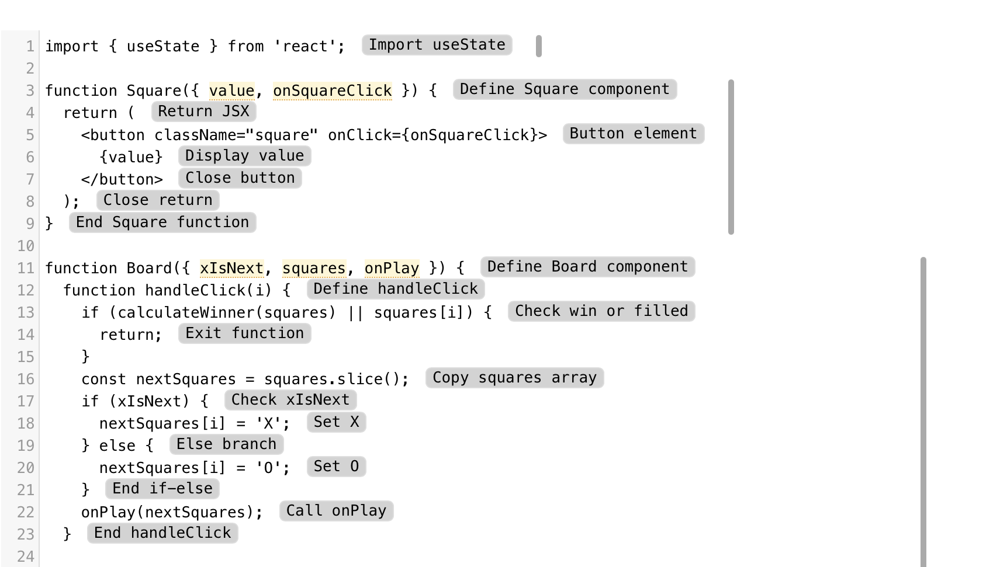
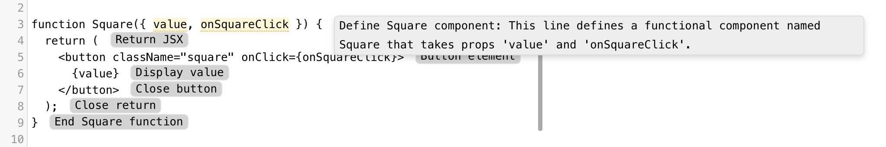
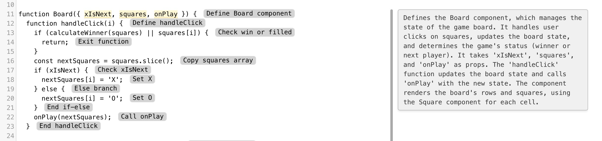
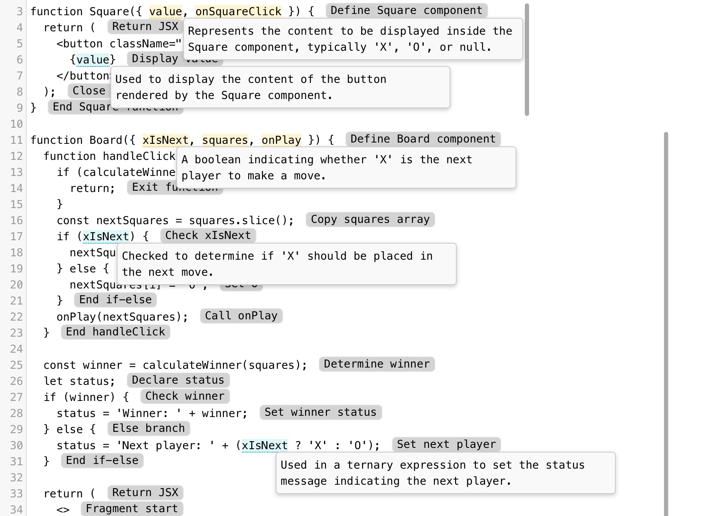

# Code Explanations

AI-powered code visualization tool that helps developers quickly understand unfamiliar code

<p align="center">
  
</p>

## Overview

Code Explanations is an intelligent code analysis tool that uses GPT-4 to automatically generate multi-layered explanations for JavaScript and Python code. Paste any code snippet and get instant, interactive annotations that break down what the code does at three hierarchical levels: line-by-line summaries, block-level analysis, and data flow tracking.

Whether you're exploring a new codebase or trying to understand complex logic, Code Explanations helps you build mental models faster.

## Features

### Line-Level Explanations
Hover over any line to see a concise summary and detailed explanation of what that specific line does.



### Block Analysis
Code is automatically divided into logical blocks, each with a comprehensive breakdown including:
- What the block does
- How it works
- Inputs and outputs
- Step-by-step process



### Data Flow Tracking
Click on any function parameter to see all occurrences throughout the code, with context-aware explanations for each usage.



## Tech Stack

**Frontend**
- React 18 - UI framework
- Vite - Build tool and dev server
- CodeMirror 5 - Code editor with custom extensions

**AI & Validation**
- OpenAI API (GPT-4o-mini) - Code analysis
- Zod - Schema validation for structured AI responses

**Code Analysis**
- JSHint - JavaScript linting
- Custom annotation system

## Getting Started

### Prerequisites
- Node.js (v16 or higher)
- OpenAI API key

### Installation

1. Clone the repository
```bash
git clone https://github.com/c-goenka/code-explanations.git
cd code-explanations
```

2. Install dependencies
```bash
cd code-explainer-react-app
npm install
```

3. Set up environment variables

Create a `.env` file in the `code-explainer-react-app` directory:
```bash
VITE_OPENAI_API_KEY=your_openai_api_key_here
```

4. Run the development server
```bash
npm run dev
```

The app will be available at `http://localhost:5173`

## How It Works

Code Explanations uses a sophisticated pipeline to analyze and visualize code:

1. **AI Analysis** ([explainer.jsx](code-explainer-react-app/src/explainer.jsx)) - Sends code to GPT-4o-mini with structured output prompts, using Zod schemas to validate and type-check the responses

2. **React Orchestration** ([App.jsx](code-explainer-react-app/src/App.jsx)) - Manages the annotation lifecycle and coordinates between the editor and AI analysis

3. **Custom Editor Extensions** ([CM5Editor.jsx](code-explainer-react-app/src/CM5Editor.jsx)) - Implements sophisticated DOM manipulation to render three types of interactive annotations with precise positioning and hover/click interactions

4. **Smart Caching** - Stores analysis results in localStorage to avoid redundant API calls and improve performance

## Architecture Highlights

- **Structured AI Output**: Uses OpenAI's beta structured output API with Zod validation for type-safe, consistent responses
- **Advanced DOM Positioning**: Sophisticated coordinate system handling for pixel-perfect tooltip placement in the code editor
- **Interactive State Management**: Toggle-based interactions for switching between parameter definition and occurrence views

## Future Enhancements

- Support for additional languages (TypeScript, Go, Rust, etc.)
- VS Code extension for in-editor explanations
- Customizable explanation depth and verbosity
- Integration with documentation systems

---
